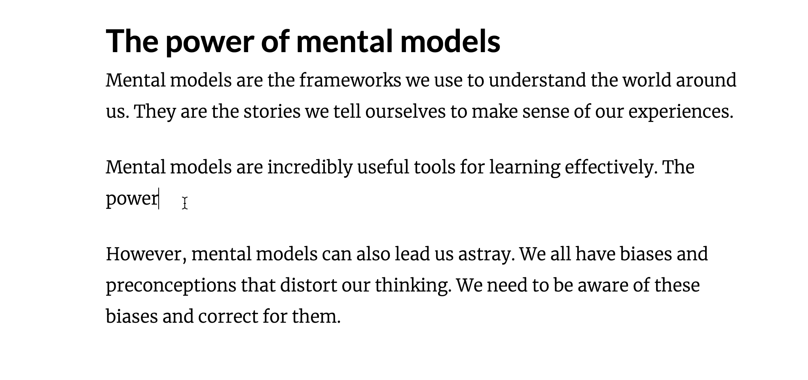

# medium-ai: An open-source AI-powered text editor

This is an AI-powered text editor whose design is inspired by [medium](https://medium.com). If you're already familiar with [medium](https://medium.com), you'll feel right at home.

**Note:** This version works with LocalAI or any OpenAI compatible API instead of requiring the official OpenAI API.

**Note:** medium-ai is an independent project and is not affliated with medium.com in any way. 

Apart from the regular features that rich text editors have, medium-ai supports the following AI features:

### AI Autosuggesion



As soon as you start typing into the editor, the article context is taken and passed onto the LLM which predicts any possible ideas that might be written. If you don't like the current suggestion, press `ctrl + space` to generate a new one. Moreover, you can select different models from the top right corner of the menu to experiment with different suggestions.

### AI Edit


To edit text, select it and enter the desired instruction in the toolbar's text field. The editor will then automatically execute the instruction and update the selected text with the result.

### Voice brain-dump

Click the mic (bottom-right) or press `Alt+V`, talk, then press it again. The recording is transcribed by `whisper-1` on your AI server and inserted after the paragraph your cursor is in. With **Tidy** on, it's first cleaned up into bullet points. Press `Esc` while recording to discard it. The microphone only works on `http://localhost` or https.

### Thinking

Models that come in pairs (`spark` / `spark-instruct`) show up once in the model menu. The **Thinking** toggle picks the thinking variant (`spark`) or the fast one (`spark-instruct`). Thinking runs with no token limit. Its reasoning streams into an indicator in the bottom-left corner (click "more" to read it all) and never goes into your document. Click **Cancel** to stop it.

## Getting started

1. Clone the repository.

```shell
git clone https://github.com/wingedrasengan927/medium-ai
```

2. Access the project directory.

```shell
cd medium-ai
```

### Frontend Installation

1. Access the frontend directory
   
   ```shell
   cd frontend
   ```

2. Install dependencies.
   
   ```shell
   npm install
   ```

3. Start dev server with hot reload at [http://localhost:5173](http://localhost:5173/).
   
   ```shell
   npm run dev
   ```

### Backend installation

The frontend will run in itself. However, if you want to save data and access AI features, the backend must be running. The editor now also supports saving your work locally in your browser using the localStorage feature. Your documents are automatically saved as you type, and you can access them again later using the unique URL generated for each document.

To utilize the backend for saving data and accessing AI features, follow the instructions below:

Before running the backend, copy `.env.example` to `.env` in the project root and set your server:

```shell
OPENAI_BASE_URL=http://192.168.1.158:8080/v1   # any OpenAI-compatible server
OPENAI_MODEL=spark                              # default model
OPENAI_API_KEY=your-key                         # use any value if your server has no auth
```

The model dropdown in the top-right is filled from the server's `/v1/models` list (embedding, TTS, OCR and image models are filtered out). "Thinking" is disabled on reasoning models so suggestions stay fast.
   
   ```
   Folder Structure:
   
   - medium-ai
   -- frontend
   -- backend
   --- app
   ---- config
   ----- .env
   ```

2. Next, it's preferable to install an anaconda virtual environment. You can install the anaconda distribution from [here](https://docs.anaconda.com/free/anaconda/install/windows/). After installation, you can create a new virtual environment and activate it using the following command:
   
   ```
   conda create -n medium-ai python==3.9 anaconda
   conda activate medium-ai
   ```

3. Next, you need to access the `backend` folder and install the requirements using the following command:
   
   ```
   cd backend
   pip install -r requirements.txt
   ```

4. Make sure you're inside the `backend` directory and run the following command to start the server running on port `8080`.
   
   ```
   python main.py
   ```

5. Finally, refresh the browser. Each document (the `?key=` in the URL) is saved to `backend/app/data/library.sqlite3` (set `DATA_DIR` to move it); the browser keeps an offline copy, and whichever copy was edited last wins. An old `editor_state.json` is imported once as the document `?key=imported-editor-state` (the file is kept). Press Ctrl+K (⌘K) to search the open document by words and meaning; semantic search uses `EMBEDDING_MODEL` on your AI server, and documents are indexed in the background.

### Docker Installation

1.  Make sure you have Docker installed. You can download it from [here](https://www.docker.com/products/docker-desktop).
2.  Navigate to the root of the project directory where the `docker-compose.yml` file is located.
3.  Create a `.env` file in the root directory and add your OpenAI API key, base URL, and model like so:

    ```
    OPENAI_API_KEY=your_api_key
    OPENAI_BASE_URL=https://your.api.endpoint
    OPENAI_MODEL=your_model_name
    ```

    You can use:
    - Official OpenAI API (https://api.openai.com/v1)
    - LocalAI (http://localhost:8080/v1) 
    - Any other OpenAI compatible API

4.  Run the following command to build and start the application:

    ```shell
    docker-compose up --build
    ```

5.  The frontend will be available at [http://localhost:5173](http://localhost:5173/) and the backend at [http://localhost:8080](http://localhost:8080/).

## End Notes

If you're looking for a template-free, open-source, AI-powered text editor, medium-ai is the right choice.

However, it is still in its early days and has some unnoticed bugs. I will keep on improving it with time. If you find any bugs or have any suggestions, please raise an issue. Also, if you want to contribute to the project, please check out the GitHub repository.

**Note**: It's important to take backup of your articles frequently and store it elsewhere just in case something goes wrong.

## Acknowledgements

1. medium-ai is built using [Lexical](https://lexical.dev) - a text editor framework developed by Meta. Most of the plugins are taken from the [lexical playground](https://playground.lexical.dev/) and have been modified slightly.
2. [DaisyUI](https://daisyui.com/) has been used to create most of the UI components.

Thanks to lexical core members and the amazing community for all the help.

## License

This project is licensed under the MIT License.
